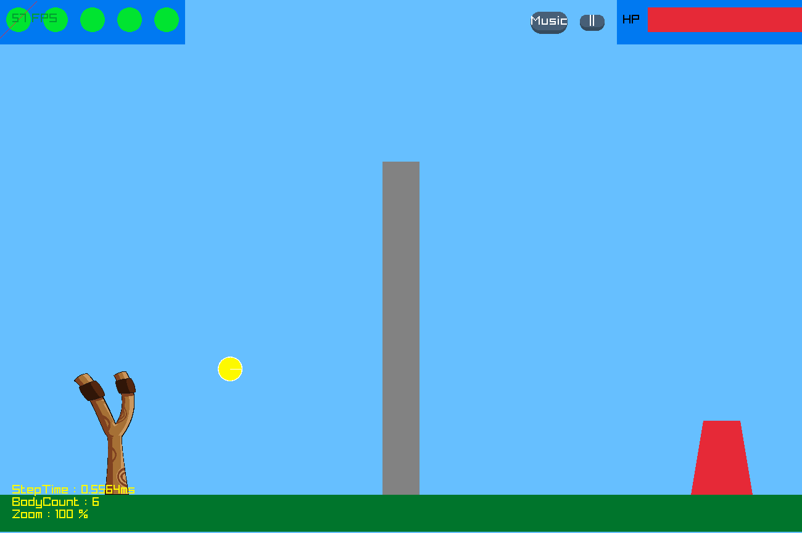
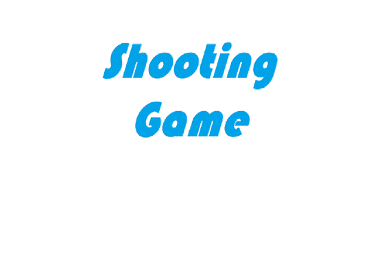

# ShootingGame

A small slingshot shooting game written in C++ with raylib, running on a hand-written 2D physics engine.

Hobby project from 2023, made by a study group. It continues the game prototype
from [FlatPhysics](https://github.com/NaNIsaac/FlatPhysics): launch a limited number of shots to bring
the enemy's HP to zero; damage depends on how hard it is hit.

## Screenshots

 



## Requirements

- Windows, Visual Studio 2022 with "Desktop development with C++" (toolset v143)
- raylib 4.2, bundled as 32-bit headers and libraries in `include/` and `lib/`

## Run

1. Open `FlatPhysics.sln` (the project kept the engine's name).
2. Run (F5). The build copies `lib\raylib.dll` next to the exe.

Textures, music and sounds are loaded from `asset/`, so the game must start with `FlatPhysics/`
as the working directory (the Visual Studio default).

## Controls

- Start / Exit buttons on the title screen
- Drag and release the projectile with the left mouse button to launch it; the launch speed depends only on the pull, not on the frame rate
- Mouse wheel: zoom, arrow keys: pan the camera, `T`: reset the camera
- `||` button: pause menu, `Music` button: switch or mute background music
- `C` / `G`: jump to the game-clear / game-over screen (debug shortcuts)

## Structure

- `FlatPhysics/src/Engine/` - physics engine and raylib helpers
- `FlatPhysics/src/Game/` - entry point (`Application.cpp`) and game logic
- `FlatPhysics/asset/` - textures, music and sound effects

## Build from the command line

Rebuilt on 2026-10-23 without source changes, using MSBuild from the Visual Studio 2022 Build Tools
(MSVC 14.44, toolset v143); only conversion and template warnings were reported:

```
MSBuild FlatPhysics.sln -p:Configuration=Debug
cd FlatPhysics
..\Debug\FlatPhysics.exe
```

The build copies `lib\raylib.dll` into `Debug\`. The window is 1300x864.

## Contributors

Made by a study group of the 2023 spring semester at Sogang University. Its members first wrote a slingshot game
on their own ([kimnoa/2023_1_project](https://github.com/kimnoa/2023_1_project),
[culee1999/shooting_game](https://github.com/culee1999/shooting_game), May 2023) and on 2023-05-25 and
2023-05-26 moved it onto the engine. Members: [NaNIsaac](https://github.com/NaNIsaac),
[culee1999](https://github.com/culee1999) and [kimnoa](https://github.com/kimnoa). kimnoa also reported the
raylib build errors on a fresh clone that led to the build fixes. The physics engine is a copy of
[FlatPhysics](https://github.com/NaNIsaac/FlatPhysics), which NaNIsaac wrote alone.

The git history of `main` records NaNIsaac; the branches `Kim` (commit `31edead`, "+Kim"), `Yong` and
`master` also exist. `코드구조.pptx` is the same code-structure slide deck as in FlatPhysics.

## 2023 spring study group

ShootingGame was the last project of the study group. The repositories of its members from that spring, by
first commit date:

| When | Repository | What | Status |
|---|---|---|---|
| 2023-03-01 | [NaNIsaac/ScreenSaver](https://github.com/NaNIsaac/ScreenSaver) | openFrameworks scenes, one per member | study |
| 2023-03-01 | [culee1999/Screen_Saver](https://github.com/culee1999/Screen_Saver) | a screensaver by culee1999 | study |
| 2023-03-01 | [culee1999/Brick_break](https://github.com/culee1999/Brick_break) | brick breaker (created 2023-02-28) | not confirmed whether it belongs to the study |
| 2023-03-17 to 2023-05-26 | [NaNIsaac/FlatPhysics](https://github.com/NaNIsaac/FlatPhysics) | 2D physics engine by NaNIsaac alone; the game branches of 2023-05-25 and 2023-05-26 are the group's | engine: solo |
| 2023-05-05 to 2023-05-20 | [culee1999/shooting_game](https://github.com/culee1999/shooting_game) | first slingshot game | study |
| 2023-05-18 | [kimnoa/2023_1_project](https://github.com/kimnoa/2023_1_project) | slingshot game, described as "2023년 봄학기 스터디그룹" | study |
| 2023-05-26 | NaNIsaac/ShootingGame (this repository) | the group's game on the FlatPhysics engine | study, last project |

## Origin

The first commit (`edd9f12`) is dated 2023-05-26, the day FlatPhysics's last commits were made; the engine
and game code were then extended here with damage, a crash sound and unloading of resources.
